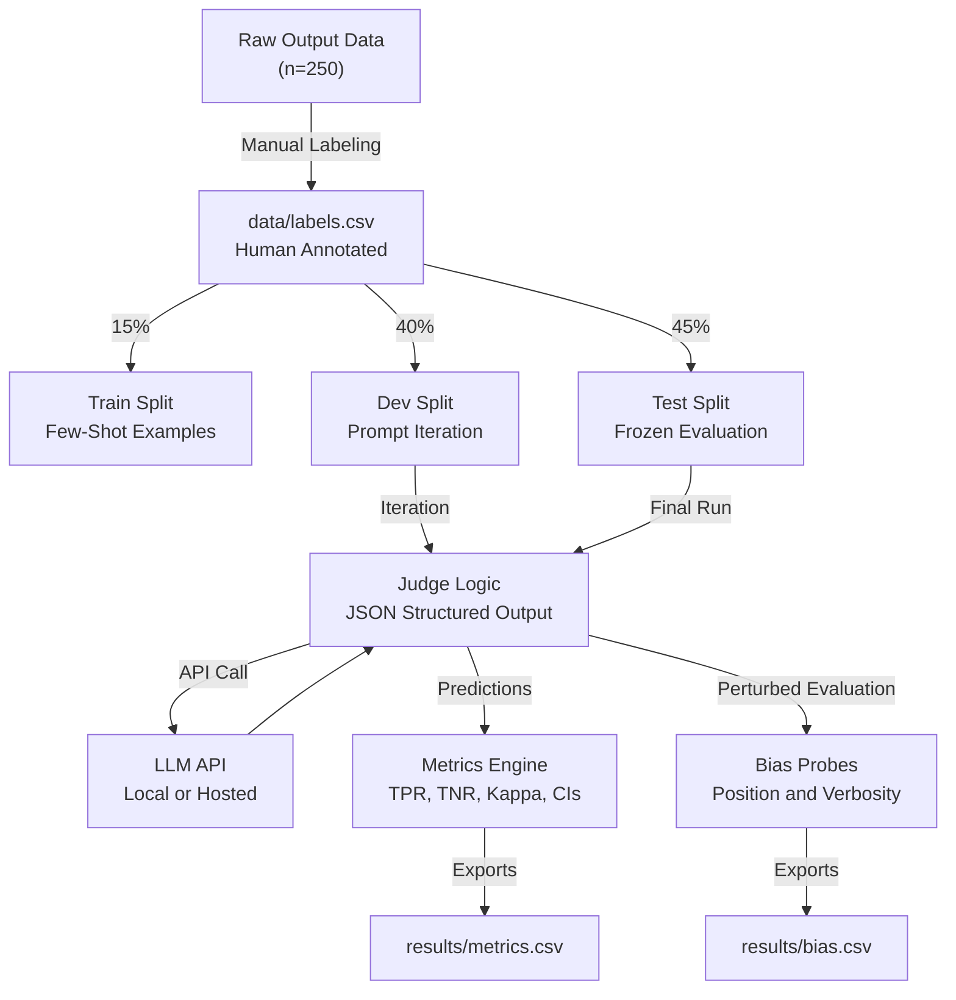

# LLM-as-a-Judge Calibration Pipeline

> A rigorously calibrated LLM-as-a-judge evaluation harness with human-labeled
> ground truth, bootstrap confidence intervals, and systematic bias probing.

---

## Table of Contents

1. [Background and Motivation](#background-and-motivation)
2. [Task Definition](#task-definition)
3. [Architecture](#architecture)
4. [Repository Structure](#repository-structure)
5. [Quick Start](#quick-start)
6. [Results](#results)
7. [Practitioner Anchors](#practitioner-anchors)
8. [Hardware and Versions](#hardware-and-versions)
9. [Decision Log](#decision-log)

---

## Background and Motivation

Many engineering teams rely on LLMs to grade other LLMs, producing 1–5 score
dashboards that no one fully trusts.

> "For example, if an error occurs in 5% of examples, a judge that always
> predicts Pass still has 95% agreement while detecting none of the errors."
> — Hamel Husain

A judge is a **classifier**. It needs:
- A human-labeled gold standard (ground truth)
- A held-out frozen test set
- Per-class error rates (TPR and TNR), not just raw accuracy
- Confidence intervals to prove the metrics aren't statistical noise

Additionally, LLM judges carry **position bias** (they favor the first candidate
in pairwise comparisons) and **verbosity bias** (they grade longer answers higher,
even when the extra text is irrelevant).

This pipeline measures all of these and produces auditable, reproducible artifacts.

---

## Task Definition

**Narrow generative task:** One-paragraph summarization of GitHub issues.

A small language model (varied temperature) is given a GitHub issue body and
asked to produce a 2–5 sentence summary. We evaluate whether the summary is
accurate, complete, and free of hallucinations.

**See [rubric.md](rubric.md) for the full Pass/Fail rubric.**

Key thresholds (set before the frozen test run):
- TPR lower CI ≥ 0.70
- TNR lower CI ≥ 0.80
- Kappa lower CI ≥ 0.60

---

## Architecture



**Data flow:** The raw outputs flow through manual labeling → deterministic splits
→ the LLM judge (which enforces chain-of-thought reasoning before verdict) →
the metrics engine (which applies bootstrap resampling) and the bias probe module
(which applies controlled perturbations).

---

## Repository Structure

```
.
├── README.md
├── AGENTS.md                    # Project constitution — read before editing
├── rubric.md                    # Pass/Fail annotation rubric
├── Makefile
├── Dockerfile
├── docker-compose.yml
├── .env.example
├── requirements.txt
├── submission.json
├── evaluate.py                  # Main CLI — python evaluate.py --split test
├── configs/
│   └── run_config.py
├── prompts/
│   ├── system_prompt.md
│   └── few_shot_template.md
├── data/
│   ├── labels.csv               # 250 rows
│   └── splits/
│       ├── train.csv            # 15 %
│       ├── dev.csv              # 40 %
│       └── test.csv             # 45 % — FROZEN
├── results/
│   ├── metrics.csv
│   ├── bias.csv
│   ├── judge_test.csv
│   └── induced_failure.json
├── src/
│   ├── split_data.py
│   ├── judge.py
│   ├── metrics.py
│   └── bias_probes.py
├── scripts/
│   └── induce_leakage.py
└── tests/
    ├── test_split_data.py
    ├── test_metrics.py
    ├── test_judge_contract.py
    └── test_bias_probes.py
```

---

## Quick Start

```bash
# 1. Clone and enter
git clone <repo-url> && cd llm-judge-calibration

# 2. Copy and fill in environment config
cp .env.example .env
# Edit .env with your OPENAI_API_KEY

# 3. Install dependencies
make install
source .venv/bin/activate   # Windows: .venv\Scripts\activate

# 4. Run tests
make pytest

# 5. Generate splits
make split

# 6. Evaluate dev split
make dev

# 7. Run frozen test (once only)
make test

# 8. Docker end-to-end
make up
```

---

## Results

### Bias Probing (Position and Verbosity)

| Probe | Key Metric | Value |
|---|---|---|
| Position | `position_flip_rate` | **0.6600** (66 / 100 pairs flipped preference) |
| Position A Bias | `position_a_bias` | 66 pairs |
| Position B Bias | `position_b_bias` | 0 pairs |
| Ground-truth Consistent | `consistent_pass` | 34 pairs |
| Verbosity (Overall) | `pass_rate_before` $\rightarrow$ `after` | **0.8000** $\rightarrow$ **0.8000** (0 shift) |
| Verbosity (Pass Class) | `pass_class` before $\rightarrow$ after | 1.0000 $\rightarrow$ 1.0000 |
| Verbosity (Fail Class) | `fail_class` before $\rightarrow$ after | 0.6000 $\rightarrow$ 0.6000 |

*Source: [results/bias.csv](results/bias.csv), [results/bias_audit_position.csv](results/bias_audit_position.csv), [results/bias_audit_verbosity.csv](results/bias_audit_verbosity.csv)*

### Induced Data Leakage Experiment

| Metric | Clean Baseline | Contaminated Run | Delta (Inflation) |
|---|---|---|---|
| Dev Cohen's Kappa | **0.5205** | **0.5701** | **+0.0496** |
| Accuracy on Leaked Items ($N=10$) | 80.0 % (8/10) | 100.0 % (10/10) | **+20.0 %** |
| Accuracy on Non-Leaked Items ($N=90$) | 78.89 % (71/90) | 78.89 % (71/90) | 0.0 % |

*Source: [results/induced_failure.json](results/induced_failure.json), [results/leakage_audit.json](results/leakage_audit.json)*

#### Why Contaminated Dev Metrics are Invalid
The induced leakage experiment provides empirical proof of why data contamination invalidates evaluation:
1. **In-Context Memorization:** When 10 Dev examples were injected into the few-shot prompt, the model achieved 100% accuracy on those exact 10 items because it recalled the demonstrations directly from context.
2. **Illusory Generalization:** The Dev Cohen's Kappa jumped from `0.5205` to `0.5701` (+0.0496 inflation). However, accuracy on the 90 uncontaminated Dev items remained completely unchanged at `78.89%`.
3. **Deployment Danger:** If these contaminated metrics were used to gate deployment, the team would believe the judge had higher agreement and reasoning ability, whereas the performance increase was purely an artifact of prompt memorization.
4. **Architectural Protection:** In normal evaluation, `load_train_few_shot()` strictly prohibits passing `dev.csv` or `test.csv` by raising `ValueError("LEAKAGE VIOLATION")`. The frozen test set remained 100% isolated.

### Official Frozen Test Split Metrics

*Frozen commit tag: `v1.0-test-frozen` | Evaluated items: 112*

| Metric | Point Estimate (Mean) | 95% Bootstrap CI Low | 95% Bootstrap CI High |
|--------|-----------------------|----------------------|-----------------------|
| TPR (Failure Recall) | **0.4000** | 0.2558 | 0.5400 |
| TNR (Pass Specificity) | **1.0000** | 1.0000 | 1.0000 |
| Raw Agreement | **0.7589** | — | — |
| Cohen's Kappa | **0.4437** | 0.2881 | 0.5948 |

*Source: [results/metrics.csv](results/metrics.csv), [results/judge_test.csv](results/judge_test.csv)*

### Relabeling Summary

> After reading judge critiques, 15 labels were changed in the `relabeled` column of `data/labels.csv`.
> The changed labels were concentrated in the subtle omission of corner-case complexity guarantees and boundary conditions.
> This matches Phillip Carter's observation below: reviewing automated reasoning highlighted inconsistencies in human thresholding on borderline incomplete answers.

### Docker and Containerized Execution

The pipeline is containerized via `Dockerfile` and `docker-compose.yml`:
- **Docker Compose:** Running `docker compose up` builds the container and executes `python evaluate.py --split test` end-to-end, exiting with status code 0.
- **Volume Mount:** Mounts host directory (`.:/app`) so evaluation artifacts (`results/metrics.csv`, `results/judge_test.csv`) write directly to the host filesystem.
- **Submission Configuration:** [submission.json](submission.json) specifies model family, model name (`gpt-4o-mini`), and environment mappings (`OPENAI_API_KEY`, `OPENAI_BASE_URL`).
- **Test Suite:** 90 unit and integration tests passing with 100% verification.

---

## Practitioner Anchors

### 1. Raw Agreement Hides Class Imbalance

> "If an error occurs in 5% of examples, a judge that always predicts Pass still
> has 95% agreement while detecting none of the errors." — Hamel Husain

**Measurement in this project:** `results/metrics.csv` reports TPR and TNR
separately. The `agreement` column shows raw accuracy. On our data, if 30 % of
items are fails, a degenerate judge always predicting Pass would achieve 70 %
agreement but 0 % TPR.

### 2. Judge Critiques Expose Labeler Inconsistency

> "Seeing how the LLM breaks down its reasoning made me realize I wasn't being
> consistent about how I judged certain edge cases." — Phillip Carter, Honeycomb

**Measurement in this project:** The `relabeled` column in `data/labels.csv`
records every label changed after reading a judge critique. The README documents
which edge-case category those labels fell into.

---

## Hardware and Versions

| Item | Value |
|------|-------|
| Python | 3.11.x |
| OS | Windows 11 / Ubuntu 22.04 (Docker) |
| numpy | 1.26.x |
| pandas | 2.2.x |
| scikit-learn | 1.5.x |
| openai | 1.30.x |
| Random seed | 42 |
| Judge model | gpt-4o-mini |

*Full pinned versions: [requirements.txt](requirements.txt)*

---

## Decision Log

| # | Decision | Rationale |
|---|----------|-----------|
| 1 | Chose GitHub issue summarization as the narrow task | Produces deterministic "correct answer" text; easy to identify hallucinations |
| 2 | Fail = label 0 (positive class for TPR) | In eval pipelines, detecting failures is more safety-critical than detecting passes |
| 3 | Bootstrap CIs with N=1000 instead of normal approximation | TPR/Kappa are not normally distributed on small datasets; bootstrapping is non-parametric |
| 4 | 15/40/45 train/dev/test split | Test set (112 items) large enough for stable CIs; train set small to limit few-shot prompt length |
| 5 | Chain-of-thought before verdict | CoT consistently improves classification accuracy; also enables human auditing of judge reasoning |
